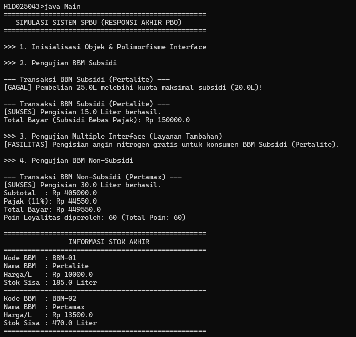

# Responsi Akhir PBO - Sistem SPBU

## Identitas Mahasiswa
- **NIM**: H1D025043
- **Nama**: Rafa Natandra
- **Tema Sistem**: SPBU

---

## Ringkasan Struktur Berkas

| File | Peran |
| :--- | :--- |
| `BahanBakar.java` | abstract superclass, konstanta `PAJAK` , atribut `private final kodeBBM` |
| `BahanBakarSubsidi.java` | subclass, implements `Operasional` , `LayananTambahan` |
| `BahanBakarNonSubsidi.java` | subclass, implements `Operasional` |
| `Operasional.java` , `LayananTambahan.java` | interface |
| `Main.java` | pengujian ke-10 persyaratan |

---


## Petunjuk Compile dan Run (Via Terminal)

1. **Buka Terminal / Command Prompt** dan masuk ke direktori tempat source code berada:
   ```bash
   cd path/to/project
   ```

2. **Compile seluruh file Java**:
   ```bash
   javac *.java
   ```

3. **Jalankan program utama**:
   ```bash
   java Main
   ```

---


## Luaran Program
